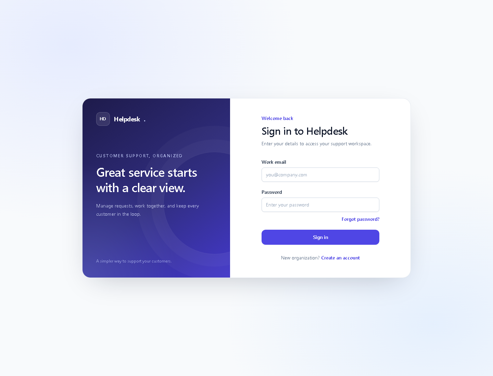
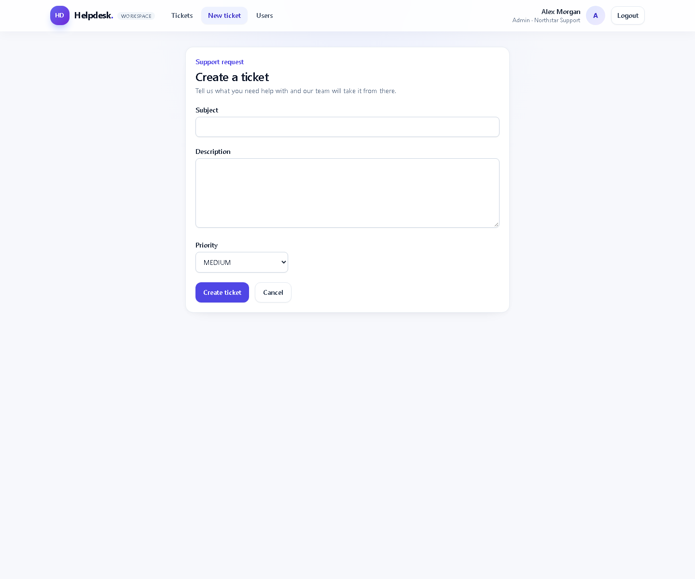
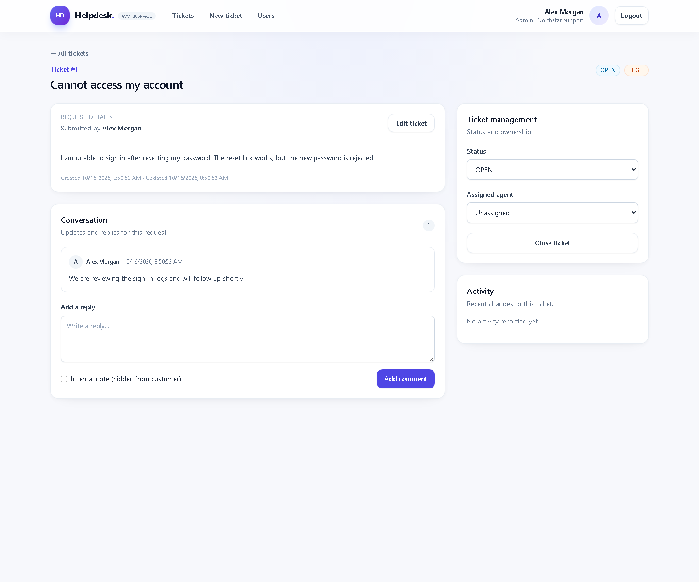

# Multi-Tenant Helpdesk & Ticketing System

Kloudspot technical assessment (Project 2). Multiple organizations manage support tickets; every organization has its own users and tickets and cannot see another organization's data.

**Stack**
- Backend: Java 17, Spring Boot 3.5, Spring Security (JWT), Spring Data JPA, PostgreSQL, Resend email API, JUnit 5 + Mockito, springdoc-openapi (Swagger)
- Frontend: React 18 + TypeScript + Vite + Tailwind CSS

## Application screenshots

The screenshots below show the sign-in, ticket creation, and ticket conversation flows.

| Sign in | Create a ticket | Ticket details and conversation |
|---|---|---|
|  |  |  |

## Project structure

```
helpdesk-ticketing-system/
├── backend/             Spring Boot app (Maven)
├── frontend/            React app (Vite)
├── docker-compose.yml   PostgreSQL
└── README.md
```

## Prerequisites
- JDK 17+
- Maven 3.9+
- Node.js 18+ and npm
- Docker (for PostgreSQL) — or use the H2 profile below, no Docker needed

## Run the backend

Before starting the PostgreSQL-backed app, copy `backend/.env.example` to `backend/.env` and replace `JWT_SECRET` with a randomly generated value as described below. The H2 profile uses a test-only key and does not require this file.

Option A: PostgreSQL via Docker (default)

```bash
docker compose up -d            # from the project root
cd backend
mvn spring-boot:run
```

Option B: use an existing PostgreSQL database via `.env`

Copy `backend/.env.example` to `backend/.env`, then set your PostgreSQL username and password in `backend/.env`. The example uses database `helpdesk` on port `5432`; change the URL if your database name, host, or port differs. Do not commit `.env` because it contains credentials.

For password reset emails, create a Resend account, generate an API key, and verify the sender domain/address in Resend. Set `RESEND_API_KEY` and `RESEND_FROM` (for example, `Helpdesk <support@your-domain.com>`) in the backend process environment or your local ignored environment file. The Resend test sender can only deliver to the account owner's address; verify a domain to send to other users. Reset links expire after 30 minutes and can only be used once.

Set a private random `JWT_SECRET` of at least 32 bytes in `backend/.env`; the backend intentionally has no fallback signing key. In PowerShell, generate one with `$rng = [System.Security.Cryptography.RandomNumberGenerator]::Create(); $bytes = New-Object byte[] 48; $rng.GetBytes($bytes); [BitConverter]::ToString($bytes).Replace('-', '').ToLowerInvariant()`. Configure `APP_CORS_ALLOWED_ORIGINS` as a comma-separated list of exact frontend origins (the default is `http://localhost:5173`). Never commit `.env` or expose server-side secrets in the frontend.

In PowerShell, from the project root:

```powershell
Copy-Item backend\.env.example backend\.env
cd backend
mvn spring-boot:run
```

Option C: no Docker, in-memory H2 database

```bash
cd backend
mvn spring-boot:run '-Dspring-boot.run.profiles=h2'
```

Backend runs on http://localhost:8080. The application starts with no demo organizations, users, or tickets. Register an organization from the login page to create its first admin, then sign in with that account. The H2 profile also starts with an empty in-memory database.

Settings can be overridden with environment variables: `DB_URL`, `DB_USER`, `DB_PASSWORD`, `JWT_SECRET`, `FRONTEND_URL`, `APP_CORS_ALLOWED_ORIGINS`, `RESEND_API_KEY`, and `RESEND_FROM`.

Public account endpoints have per-IP in-memory limits: 10 login attempts per minute, 5 organization registrations and password-reset requests per hour, and 10 reset submissions per hour. These counters are per backend process and reset on restart; production deployments with multiple instances should use a shared rate-limit store.

## Run the frontend

```bash
cd frontend
npm install
npm run dev
```

Open http://localhost:5173. Vite proxies `/api` to `http://localhost:8080`, so the backend must be running.
To use a backend on another port, set `HELPDESK_API_TARGET` before starting Vite (for example, `http://localhost:8081`).

## Run the tests

```bash
cd backend
mvn test
```

The test suite includes Mockito-based service tests and H2-backed API integration tests for customer-scoped summaries, cross-organization ticket access, and internal-note visibility.

## API documentation (Swagger)

http://localhost:8080/swagger-ui.html

1. Call `POST /api/auth/login`, copy the `token`.
2. Click **Authorize**, paste the token, then try the other endpoints.

## First-time setup

Register an organization from the login page ("Register") or via `POST /api/auth/register-org`. This creates the organization and its first admin account; no demo accounts or tickets are added automatically. The admin can create additional organization users from the Users page.

## REST API summary

| Method | Path | Who |
|---|---|---|
| POST | /api/auth/register-org | public |
| POST | /api/auth/login | public |
| POST | /api/auth/forgot-password | public |
| POST | /api/auth/reset-password | public |
| POST | /api/users | Admin |
| GET | /api/users?role= | Admin, Agent |
| POST | /api/tickets | all |
| GET | /api/tickets?status=&priority=&assignedAgentId=&search=&page=&size= | all (customers: own tickets only) |
| GET | /api/tickets/summary | all (organization-scoped; customers: own tickets only) |
| GET | /api/tickets/{id} | all (scoped) |
| PUT | /api/tickets/{id} | Admin, Agent |
| PATCH | /api/tickets/{id}/status | Admin, Agent (customer: close own ticket only) |
| POST | /api/tickets/{id}/close | all (scoped) |
| PATCH | /api/tickets/{id}/assign | Admin, Agent |
| POST | /api/tickets/{id}/comments | all (internal notes: Admin, Agent only) |
| GET | /api/tickets/{id}/comments | all (customers never receive internal notes) |
| GET | /api/tickets/{id}/history | all (scoped) |

Status codes: 200/201 success, 400 validation or malformed request, 401 missing/invalid token or bad credentials, 403 role not allowed, 404 not found (including other organizations' data), 409 duplicate email, 500 unexpected error. Errors share one JSON shape: `{ timestamp, status, message, errors[] }`.

## Tenant isolation: how it works

1. Every `User` and `Ticket` has a mandatory `organization_id`.
2. The JWT carries `userId`, `orgId` and `role`. The `orgId` used by the application is **always read from the validated JWT**, never from the request body, path or query parameters.
3. All ticket lookups are tenant-scoped (`findByIdAndOrganizationId`), and the list/search query (JPA Specification) always starts with an `organization_id = :orgId` predicate.
4. A ticket from another organization is reported as **404** (not 403), so its existence is not leaked.
5. Assigning a ticket validates that the agent belongs to the same organization.
6. New users created by an admin are always placed in the admin's own organization.
7. Customers additionally see only tickets they requested.

## Roles

| Capability | Org Admin | Support Agent | Customer |
|---|---|---|---|
| Create users (own org) | yes | no | no |
| Create ticket | yes | yes | yes |
| View tickets | all in org | all in org | own only |
| Edit ticket, change status, assign | yes | yes | no |
| Close ticket | yes | yes | own tickets |
| Write / read internal notes | yes | yes | no |

## Design notes
- Layers: controller -> service -> repository; DTOs are used for all requests/responses (entities and password hashes are never returned).
- Status and assignment changes write a `TicketHistory` row in the same transaction as the change.
- The dashboard summary endpoint returns total, open, in-progress, resolved, and closed counts scoped to the caller's organization; customers see counts for their own tickets only.
- Request validation with Bean Validation; central error handling in `GlobalExceptionHandler`.
- Schema is created by Hibernate (`ddl-auto=update`) for easy local setup; a real deployment would use Flyway/Liquibase.

## Assumptions and known limitations
- Email addresses are unique across the whole system (one account per email).
- Only agents/admins can edit ticket subject/description/priority; customers can add comments and close their own ticket.
- Admins can also be assigned tickets (shown in the assign dropdown).
- No refresh tokens, general email notifications or file attachments.
- `ddl-auto=update` is for easy local setup; use Flyway/Liquibase for production schema changes.
- Unit tests cover business logic (`TicketService`, `AuthService`) using Mockito; API integration tests use the H2 profile.
